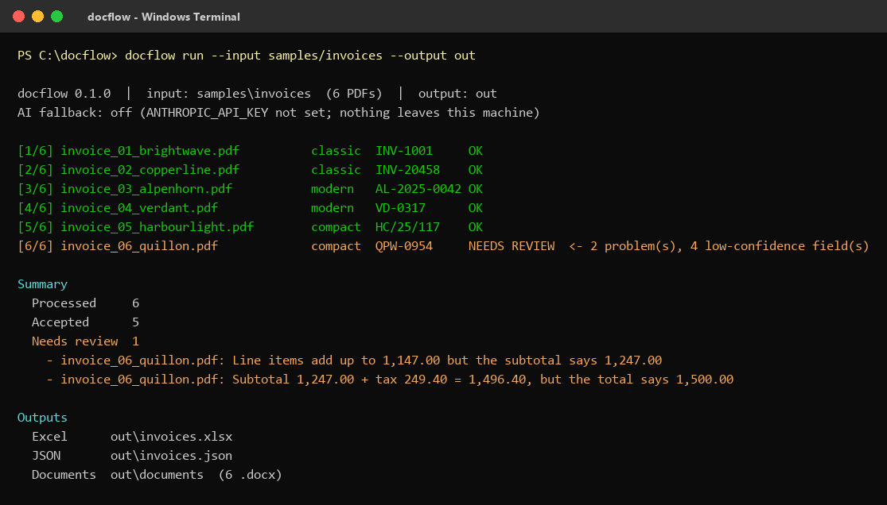
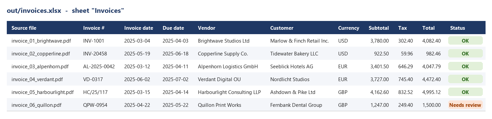

# docflow - PDF invoices to structured data, Word documents and an Excel summary

> **Portfolio project.** This is a demonstration I built to show how I would automate PDF data entry.
> It is not a product, it has no customers, and every invoice and company in this repository is
> synthetic and fictional. Nothing here is a claim about real-world accuracy or time saved.

## The problem

Someone on the team opens each supplier invoice PDF, retypes the invoice number, dates, vendor,
amounts and line items into a spreadsheet, then retypes them again into a Word template for the
file. It is slow, and a single mistyped digit goes unnoticed until the books do not add up.

## What docflow does

Point it at a folder of PDF invoices. For every file it:

1. **Extracts** invoice number, invoice and due dates, vendor, customer, currency, line items
   (description, qty, unit price, amount), subtotal, tax and total with `pdfplumber`. Three
   different invoice layouts are supported out of the box (US-style, European banded, UK-style).
2. **Validates** the result: line items must add up to the subtotal, subtotal + tax must equal the
   total, each line's qty x unit price must match its amount, required fields must be present,
   and dates must be sane (not in the future, due date not before the invoice date).
3. **Rates its own confidence** per field. Anything low-confidence, or anything that fails a check,
   is routed to a **Needs review** sheet with the exact reason. Nothing is silently accepted.
4. **Writes outputs**: one filled `.docx` per invoice, one Excel workbook, one JSON file.

## What you get

One run produces, in `out/`:

| File | Content |
|---|---|
| `invoices.xlsx` | Sheets **Invoices**, **Line items**, **Needs review** - formatted header, frozen row, filters, column widths, number and date formats |
| `documents/<invoice>.docx` | One Word document per invoice, filled from `templates/invoice.docx`; flagged invoices carry a red "NEEDS REVIEW" banner listing the problems |
| `invoices.json` | Every field with its value, confidence and source (`rule` or `ai`), plus line items and issues |

### Real output of `docflow run` on the bundled samples



Five invoices pass. The sixth is deliberately broken (its printed subtotal and total do not match
its own line items) and is caught:



Both images are generated by `scripts/make_demo_images.py` from an actual run, not drawn by hand.

## Quick start (Windows, Python 3.10+)

```powershell
python -m venv .venv; .venv\Scripts\activate
pip install -e .
docflow demo
```

`docflow demo` generates 6 synthetic invoice PDFs into `samples/invoices/`, processes them, and
writes everything to `out/`. Open `out\invoices.xlsx` to see the result.

On your own files:

```powershell
docflow run   --input path\to\invoices --output out\   # extract, validate, write all outputs
docflow check --input path\to\invoices                 # validate only; exit code 1 if anything needs review
```

Useful options: `--config` (layout rules), `--template` (Word template), `--no-docx`, `--no-ai`.

## Adapting it to a new invoice layout

Layouts live in [`config/layouts.yaml`](config/layouts.yaml); no Python changes are needed for a
typical invoice.

1. See what the parser sees:
   `python -c "from docflow.extract import read_pdf_text; print(read_pdf_text('your.pdf'))"`
2. Copy an existing block under `layouts:` and rename it.
3. Set `detect:` to one or two regexes that only this layout contains (all must match).
4. For each field choose a rule: `regex` (first capture group), `line: N` (N-th non-empty line), or
   `after: <pattern>` (the line after a match). Set `decimal` (`.` or `,`) and `date_formats`.
5. Describe the table with `start`, `end` and a `row` regex using the named groups
   `description`, `qty`, `unit_price`, `amount`.
6. Run `docflow check --input <folder>`. Rows the rules cannot read are reported, not skipped.

```yaml
  modern:
    detect: ['^Payment due:', '^Billed to$']
    decimal: ","
    date_formats: ["%d %B %Y"]
    fields:
      invoice_number: {regex: '^Invoice #\s*(\S+)'}
      customer:       {after: '^Billed to$'}
```

The Word template is a normal `.docx` using [docxtpl](https://docxtpl.readthedocs.io/) tags such as
`{{ invoice_number }}` and a `line_items` table loop. Edit it in Word; keep the tags intact.

## Optional AI fallback

If `ANTHROPIC_API_KEY` is set, fields the rules could **not** extract are sent to Claude through the
official `anthropic` Python SDK using structured output (`client.messages.parse` with a Pydantic
schema). The model is read from `DOCFLOW_MODEL` (default `claude-haiku-5-5`).

```powershell
pip install -e ".[ai]"
$env:ANTHROPIC_API_KEY = "sk-ant-..."
docflow run --input path\to\invoices --output out\
```

- Values from the AI are marked `confidence: medium`, `source: ai`, and go through exactly the
  same validation as rule-based values.
- It is called only when the rules left something missing, and only for that invoice.
- It sits behind a small `AIExtractor` interface (`src/docflow/ai.py`); swap in another provider
  by implementing one method.
- The tool works fully without a key. `--no-ai` forces it off.

## Privacy

**Local by default.** Without `ANTHROPIC_API_KEY`, docflow makes no network calls at all: PDFs are
parsed on your machine and outputs are written to local files. Only when you set the key, and only
for an invoice with fields the rules could not extract, is that one invoice's extracted text sent to
the Anthropic API. The run header always states whether the fallback is on or off. The tests make
no network calls.

## Architecture

```
PDF folder
   |  pdfplumber text                      config/layouts.yaml
   v                                              |
extract.py  --- detect layout, apply field rules --+
   |  (missing fields)  -> ai.py  (optional, medium confidence)
   v
validate.py --- sums, dates, required fields -> issues + confidence downgrades
   |
   v
pipeline.py --- routes: OK  /  Needs review
   |
   +--> excel.py   invoices.xlsx   (Invoices | Line items | Needs review)
   +--> render.py  documents/*.docx (docxtpl)  and  invoices.json
cli.py: run | check | demo        samples.py: reportlab sample generator
```

Money uses `Decimal` throughout, so sums are exact (1-cent tolerance for rounding).

## Tests

```powershell
pip install -e ".[dev,ai]"
pytest
```

42 tests, no network: extraction per layout, each validation rule, routing of the broken invoice,
Excel and Word contents, JSON, CLI exit codes, a corrupt PDF not stopping a batch, and the AI
fallback against a fake client.

## Limitations (honest list)

- Works on PDFs with a text layer. Scanned images need OCR first; docflow flags them instead of guessing.
- Layout rules are written per layout. A truly new layout needs a few lines of YAML (or the AI fallback).
- Multi-line wrapped table rows are reported as unparsed, not merged.
- The live Claude call has not been exercised in this repository's tests, only the request/response
  handling against a fake client. Check it with your own key before relying on it.
- Tested on synthetic invoices only.

## Project layout

```
config/layouts.yaml     field rules per layout
templates/invoice.docx  Word template
samples/                make_samples.py + 6 generated PDFs
scripts/                make_template.py, make_demo_images.py
src/docflow/            package
tests/                  pytest suite
docs/                   screenshots
```

Troubleshooting: on Windows, very deep folder paths (over 260 characters) can make `lxml` or Pillow
fail to load. Keep the project in a short path such as `C:\work\docflow`.

## License

MIT - see [LICENSE](LICENSE).
